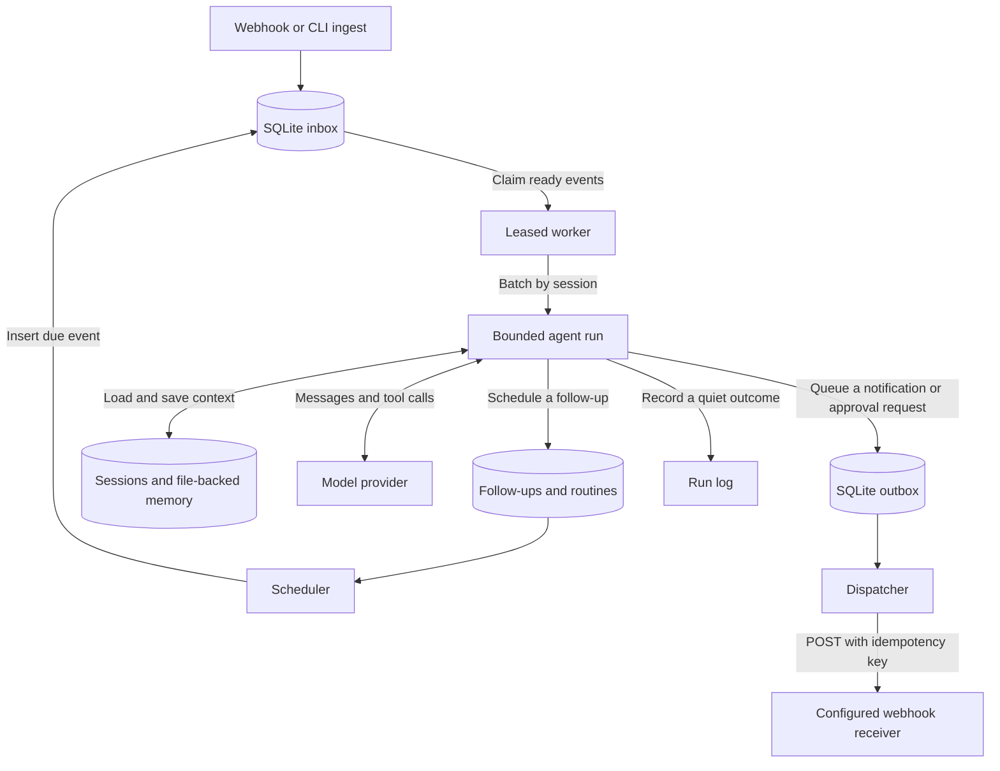
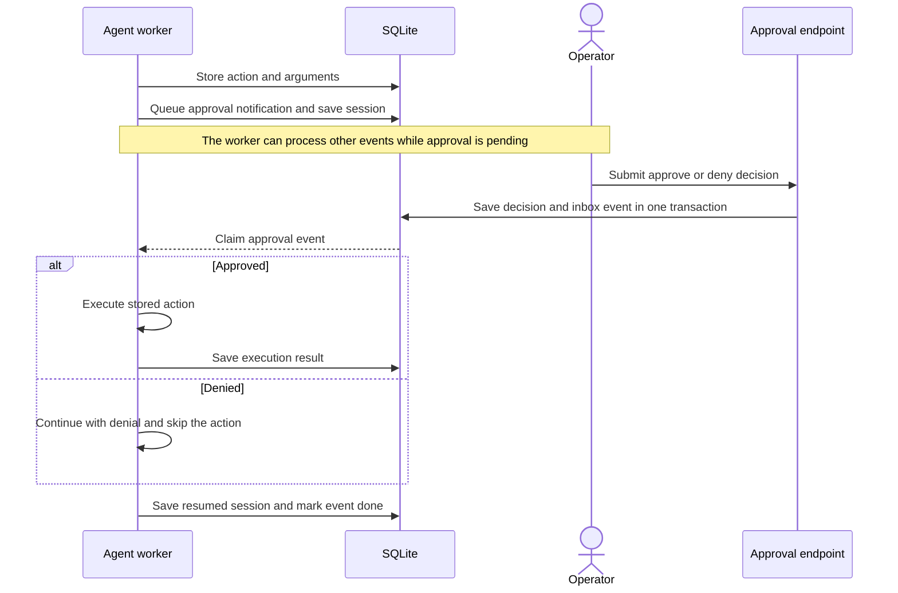
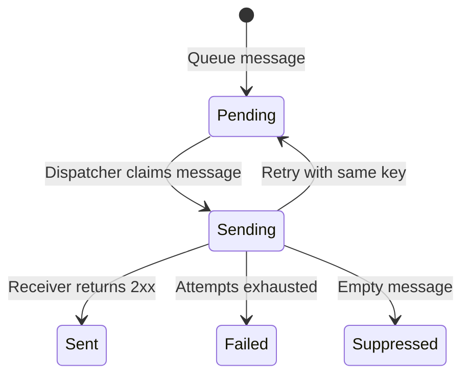

# always-on-agents

A Bun and TypeScript runtime for agents that react to webhooks, schedules, and human decisions. The service stays available while model calls happen in short, bounded runs. SQLite and a file-backed memory store preserve work across runs and process restarts. The design follows Anthropic’s [Building always-on agents](https://claude.com/resources/articles/building-always-on-agents).

## Quick start

Requires Bun 1.4.4 or later. Try a single run with the deterministic mock model and a fresh local data directory.

```bash
bun install --frozen-lockfile
bun run build

export DATA_DIR="$(mktemp -d)"
export BRAIN=mock

bun run start ingest '{"sourceId":"demo-1","sessionKey":"demo","payload":{"text":"Hello"}}'
bun run start once
bun run start metrics
```

Expect one event under `events.done` and one pending message under `outboxPending` when no delivery receiver is configured. Repeating the same ingest with the same `sourceId` deduplicates the event.

Start the HTTP service with `bun run start serve`. It defaults to `127.0.0.1:8787`. Use `serve` for continuous processing or `once` for a single scheduler, worker, and dispatcher pass. Stop a running service before running `once` against the same database, since both commands acquire the worker lease.

## How the runtime works



| Primitive | What it does |
| --- | --- |
| Inbox | Stores events before processing. The inbox ID, source, and source ID identify a delivery. Events with the same `sessionKey` share conversation history. An event with no session key starts its own session. |
| Timers | The scheduler inserts a due event and updates its timer in one transaction. One-shot follow-ups finish after firing. Recurring timers skip missed intervals and advance to the next slot. |
| Memory | SQLite holds session transcripts. The memory directory holds operator instructions, notes, and task progress. Old conversation messages can be compacted while preserving complete tool exchanges. |
| Permissions | External sends and credentialed requests wait for an operator decision. The runtime stores the proposed arguments before approval and uses them when executing the action. |
| Outbox | Stores notifications separately from agent runs. A dispatcher sends them when a receiver is configured. Runs can finish quietly when there is nothing to report. |

The worker renews its lease while a model call is active and checks its ownership before writing results. If the worker exits mid-run, its successor can reclaim the event. Processing failures back off before retrying and eventually move to the dead-letter state. Runs are bounded by time, turns, and token budgets. Daily budgets are tracked in UTC.

### Data and model configuration

The default data directory is `./data`. Set `DATA_DIR` to a persistent local directory for a long-running service.

| Path under `DATA_DIR` | Contents |
| --- | --- |
| `runtime.db` | Events, timers, routines, sessions, approvals, outbox, and run history |
| `memory/` | `instructions.md`, memory index, notes, and progress files |
| `transcripts/` | Per-run transcript snapshots |
| `STOP` | Presence of this file pauses processing and signals active calls to stop |

`BRAIN=auto` selects Anthropic, OpenAI, or Gemini in that order when the corresponding API key is configured. It falls back to the mock model when no key is available. Set `BRAIN=mock|anthropic|openai|gemini` to select explicitly. A live provider requires its API key. Anthropic uses prompt caching for the stable memory prefix. See [`.env.example`](.env.example) for settings.

When upgrading from the earlier Node runtime, stop the old process and point Bun at the existing data directory. The existing SQLite database opens in place.

## Ingest events and review approvals

With `serve` running, send an event to the inbox over HTTP.

```bash
curl --fail-with-body http://127.0.0.1:8787/events \
  -H 'content-type: application/json' \
  -d '{"source":"webhook","sourceId":"deliv-1","sessionKey":"thread-1","payload":{"text":"hello"}}'
```

This example assumes a local instance without `WEBHOOK_SECRET`. When a webhook secret is configured, send `x-signature` with a hex HMAC-SHA256 over the exact request bytes. The response reports whether the event was inserted. Processing and delivery happen independently after ingestion.

When a run requests approval, it saves the proposed action, queues an approval notification, and ends. Other events can continue while the operator reviews the request.



Open [the dashboard](http://127.0.0.1:8787/ui) and enter the configured `APPROVAL_SECRET` to review the stored arguments. The same secret authorizes the approval endpoint.

```bash
curl --fail-with-body http://127.0.0.1:8787/events/approval \
  -H 'content-type: application/json' \
  -H "x-approval-secret: ${APPROVAL_SECRET}" \
  -d '{"deferredId":"<uuid>","decision":"approved"}'
```

## Routines and delivery

Set `AGENT_NAME` to label the runtime. A named routine combines an operator-authored instruction with a fixed interval. Each routine has its own session and recent run history. Saving an existing name changes its instruction and interval and preserves its paused state. A test run queues an event immediately without changing the schedule.

```bash
bun run start routine save release-digest 3600 "Review release notes and report actionable changes."
bun run start routine test release-digest
bun run start routine history release-digest
bun run start routine pause release-digest
bun run start routine resume release-digest
bun run start routine list
```

Use `serve` to process routine events continuously or run `bun run start once` after queuing a test when the service is stopped.

### Webhook delivery

Set `DELIVERY_WEBHOOK_URL` to a trusted HTTPS receiver. Loopback HTTP endpoints are supported for local development. The runtime sends JSON containing the message ID, inbox ID, channel, body, metadata, and idempotency key. Return a 2xx response after accepting the message and deduplicate retries using the `Idempotency-Key` header. Approved sends arrive on the `external` channel, and the receiver owns final delivery to the destination. Approval notifications omit the stored tool arguments, which are available in the authenticated dashboard.



Without a receiver, messages stay queued. Existing `sent` rows from earlier versions may represent console output. If a receiver accepts a request just before STOP or a network failure, it can still complete the action.

## Operating the service

The optional dashboard shows recent events, runs, timers, approvals, backlog counts, and outbox status. Set `APPROVAL_SECRET` before startup, or disable the dashboard with `ENABLE_UI=false`. A non-loopback bind requires an explicit operator secret of at least 24 characters and a webhook secret. Use an HTTPS reverse proxy for remote access.

```bash
curl --fail-with-body http://127.0.0.1:8787/health
curl --fail-with-body http://127.0.0.1:8787/metrics
bun run start stop
bun run start resume
bun run start silences
```

For credentialed requests, configure `AOA_SECRET_<NAME>`, `AOA_ENDPOINT_<NAME>`, and `AOA_METHODS_<NAME>`. The proxy enforces the exact HTTPS endpoint and allowed methods, blocks redirects, and exposes only the response status. If a credentialed request is interrupted after it starts, verify the result at the service before approving another attempt. Inbox payloads are wrapped as untrusted data and screened before they reach the model.

## Code map

| Area | Entry points |
| --- | --- |
| Service and CLI | [Runtime](src/runtime.ts), [CLI](src/cli.ts), [HTTP handler](src/http/handler.ts) |
| Agent execution | [Worker](src/worker/worker.ts), [agent loop](src/agent/loop.ts), [tools](src/agent/tools.ts) |
| Durable state | [Schema](src/db.ts), [inbox](src/inbox/store.ts), [timers](src/timers/store.ts), [routines](src/timers/routines.ts), [memory](src/memory/store.ts) |
| Permissions and delivery | [Approved execution](src/permissions/execute-approved.ts), [credential proxy](src/permissions/proxy.ts), [dispatcher](src/outbox/dispatcher.ts) |

Run `bun run typecheck`, `bun run test`, and `bun run build` before contributing. [GitHub Actions](.github/workflows/ci.yml) runs the same checks on pull requests and pushes to `main`.

## License

MIT
